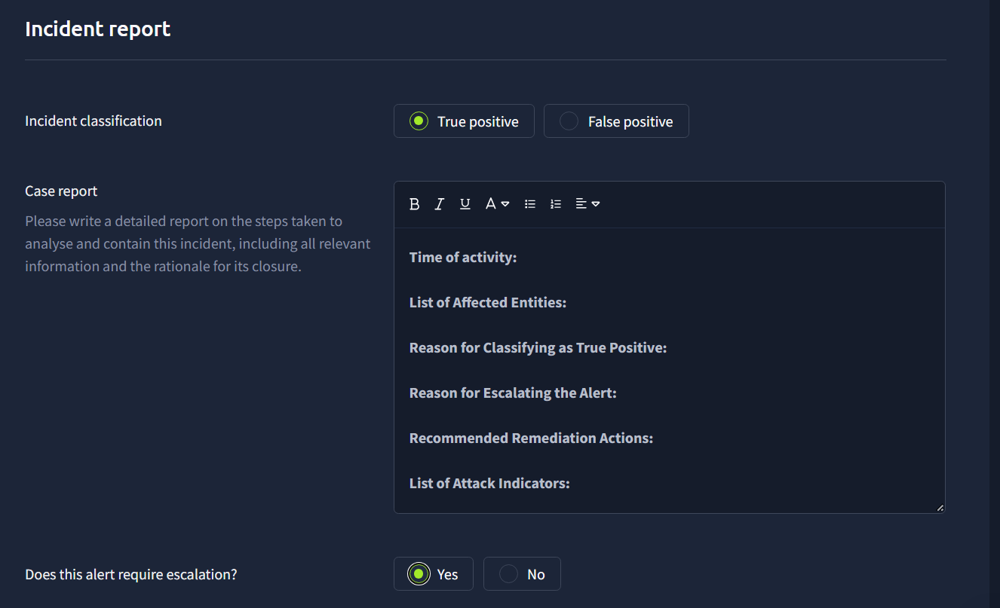

# TryHackMe case form — Alert 1034

Classification: True positive

Escalation required: Yes

**Time of activity:**
The reviewed SIEM activity occurred on October 6, 2026, approximately 16:35:49–16:40:56 in the SIEM display, with raw timestamps one hour ahead. Alert 1034 lists October 9, 2026, at 16:43:27.514. This date discrepancy remains unresolved and limits exact alert-to-event correlation.

**List of Affected Entities:**
Host: win-3450.
User context: SSF\michael.ascot.
Targeted file: C:\Users\michael.ascot\Downloads\BitcoinWalletPasscodes.txt.
Processes: powershell.exe and nslookup.exe. DNS-related child processes reference PowerShell parent PID 3728. Earlier Powercat activity references PowerShell PID 3880, launched by explorer.exe PID 3180.

**Reason for Classifying as True Positive:**
I reviewed Sysmon and PowerShell telemetry using host, domain, executable, and PID searches. PowerShell execution details showed file contents being read, Base64-encoded, divided into chunks of up to 30 characters, and passed to nslookup as subdomains of haz4rdw4re[.]io. The combined host/domain/nslookup search returned 10 matching records, with visible Sysmon Event ID 1 records corroborating repeated nslookup launches under PowerShell PID 3728. This supports attempted DNS data exfiltration rather than routine DNS troubleshooting. Successful delivery to an external receiver has not been confirmed.

**Reason for Escalating the Alert:**
The script targets potentially sensitive wallet information and attempts to transfer it through DNS. Earlier activity also shows a Powercat command consistent with a reverse-shell attempt to 2.tcp.ngrok[.]io:19282. Its connection success and direct relationship to PID 3728 remain unconfirmed. SOC L2/incident response investigation is required to assess exposure, scope the host, and resolve the missing parent-process telemetry and date discrepancy. The alert should be escalated rather than closed as benign.

**Recommended Remediation Actions:**
Isolate win-3450 under the incident-response playbook; preserve PowerShell, Sysmon, DNS, network, and endpoint evidence before remediation; block haz4rdw4re[.]io and the identified shell destination; investigate the initial execution source and other affected hosts; assess the targeted file and rotate exposed secrets if compromise is verified. These are recommendations. No containment, blocking, credential rotation, or remediation has been performed or verified during this investigation.

**List of Attack Indicators:**
DNS destination: haz4rdw4re[.]io.
Potential shell destination: 2.tcp.ngrok[.]io, TCP port 19282.
File targeted by the observed script: BitcoinWalletPasscodes.txt.
Behavior: PowerShell file reading, Base64 encoding, chunking, and repeated nslookup execution with encoded subdomains.
Supporting context: -ExecutionPolicy Bypass; downloads\exfiltration\ working directory; Powercat retrieval from the visible raw.githubusercontent.com/besimorhino/powercat/ URL prefix. The URL suffix was clipped. Legitimate services and tools are indicators in this context, not proof of maliciousness by themselves.

The screenshot shows the form before the drafted report was entered. Submission has not been verified.
